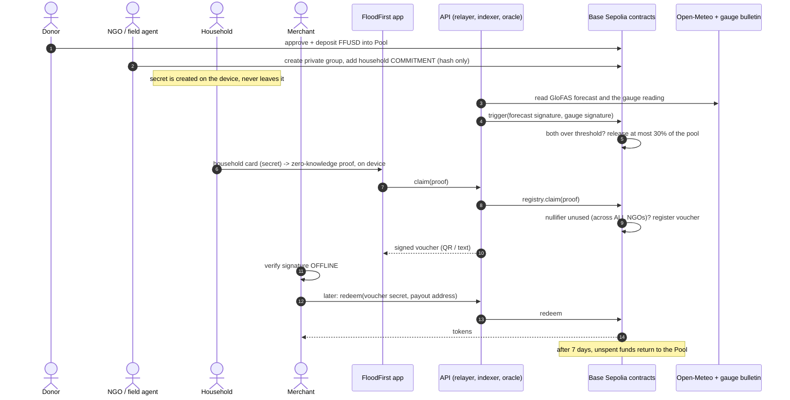

# FloodFirst

**Anticipatory flood cash, on a public testnet, with a shared registry that stops two NGOs paying the same household and never makes either of them share a list.**

> **Testnet only. No independent security audit. Tokens have no value.** Built for the *Web3 for Social Good Hackathon 2026* (SMU SCIS, GSR Foundation, University of Málaga, DoraHacks). Product spec: [FloodFirst-PRD.md](FloodFirst-PRD.md). Design critique of one of the building blocks we rely on: [FEEDBACK.md](FEEDBACK.md).

| | |
| --- | --- |
| Network | Base Sepolia (chain id 84532) |
| Live site (landing page only) | https://floodfirst.vercel.app |
| Source | https://github.com/SamuelDharshi/FloodFirst |
| Tests | 213 automated tests (59 contracts, 74 services, 80 web) |

---

## Contents

1. [The idea](#1-the-idea)
2. [How it works, in one sequence diagram](#2-how-it-works-in-one-sequence-diagram)
3. [The app in ASCII: seven diagrams](#3-the-app-in-ascii-seven-diagrams)
4. [Who uses it](#4-who-uses-it)
5. [How to use the app, step by step](#5-how-to-use-the-app-step-by-step)
6. [Quick start (run it yourself)](#6-quick-start-run-it-yourself)
7. [Configuration](#7-configuration)
8. [Smart contracts](#8-smart-contracts)
9. [Backend: API, relayer, indexer, oracle, CLI](#9-backend-api-relayer-indexer-oracle-cli)
10. [Data sources and the trigger rule](#10-data-sources-and-the-trigger-rule)
11. [Privacy and security model](#11-privacy-and-security-model)
12. [What is real, what is staged, what is missing](#12-what-is-real-what-is-staged-what-is-missing)
13. [Testing](#13-testing)
14. [Deployment](#14-deployment)
15. [Troubleshooting](#15-troubleshooting)
16. [Repository layout and documentation index](#16-repository-layout-and-documentation-index)

---

## 1. The idea

### The problem

Floods are forecast days ahead, yet help usually arrives **after** the damage. Two things go wrong:

1. **Aid is slow and opaque.** Disbursement happens after the peak, and the people funding it cannot see what happened.
2. **Aid is duplicated and missed.** Several NGOs often serve the *same villages*. Each guards its beneficiary list (it must, for privacy), so nobody can tell that household *X* was paid by NGO A **and** NGO B, while household *Y* was paid by nobody.

```
   TODAY                                         WITH FLOODFIRST
   -----                                         ---------------
   flood peaks ---> damage ---> aid arrives      forecast + gauge agree --> cash released
                                (late, maybe                              BEFORE the peak
   NGO A list  (private)         twice)
   NGO B list  (private)  ... nobody can compare  NGO A list (private) \
                                                  NGO B list (private)  >-- shared registry sees
                                                                       /    only hashes, rejects repeats
```

### The solution

A donor **pool** pre-funds small voucher tranches. They are released **automatically** when two independent sources agree that a flood is coming:

- a **flood forecast** (GloFAS river discharge via Open-Meteo), and
- a **river gauge** reading.

Households claim a voucher with a **zero-knowledge proof** made on their own device. A **shared nullifier registry** rejects a second claim from the same household for the same event, **whichever NGO enrolled it**, without any NGO seeing another's list. A local merchant **verifies the voucher offline** and is paid when connectivity returns. Anything unspent **expires back to the pool**, so a false alarm costs only what households actually redeemed.

### Why Web3 is the right tool here

| Need | Why a single database cannot do it |
| --- | --- |
| Rival NGOs deduplicate without sharing lists | Nobody will trust a competitor's database; a public contract holding only hashes is neutral ground |
| Donors verify that money moved on a *verified* trigger and reached households once | Every release, claim, redemption and return is a public event anyone can audit |
| Rules that cannot be quietly changed | The 30% cap, the two-signal rule and the expiry are enforced by contracts, not by policy |

### Design goals (from the PRD)

1. Release capped voucher tranches when a **2-of-2** trigger fires.
2. Block a second payment across NGOs **without** list sharing.
3. Let a household with **no wallet and no data** claim and redeem.
4. Give donors a public, **aggregate** audit view.
5. **State honestly where the system is weak** (see [section 12](#12-what-is-real-what-is-staged-what-is-missing)).

---

## 2. How it works, in one sequence diagram



The same flow in plain ASCII:

```
 Donor        NGO/agent     Household     Merchant     API/relayer      Chain
   |             |              |             |             |             |
   |--- deposit FFUSD into Pool --------------------------------------->  |
   |             |-- add commitment (hash) to NGO group ---------------->  |
   |             |              |             |             |             |
   |             |              |             |   forecast + gauge        |
   |             |              |             |   both over threshold --->| trigger
   |             |              |             |             |   release <=30%
   |             |              |-- card -> ZK proof (on device)          |
   |             |              |------------ claim(proof) ->|--- claim ->| nullifier new?
   |             |              |<-- signed voucher (QR) ----|<-- ok ------|
   |             |              |-- shows QR -->|           |             |
   |             |              |             verify offline  |             |
   |             |              |             |--- sync (redeem) -------->| pays merchant
   |             |              |             |             |             |
   |             |              |             |             |   day 7: expire -> unspent back to Pool
```

---

## 3. The app in ASCII: seven diagrams

### 3.1 System architecture

```
 +----------------------------- BROWSER (PWA) ------------------------------+
 |  Home | Dashboard | Donate | Field agent | Claim | Merchant | How it works|
 |  - household secret + ZK proof are made HERE (never uploaded)            |
 |  - merchant voucher check runs OFFLINE (service worker + cached signer)  |
 +--------------------------------+-----------------------------------------+
                                  | HTTPS (same port in single-port mode)
 +--------------------------------v-----------------------------------------+
 |                    FloodFirst API  (Node + Fastify)                      |
 |  /api/claim  /api/voucher  /api/redeem  /api/expire   <- relayer         |
 |  /api/stats  /api/events   /api/groups  ...           <- read API        |
 |  /admin/gauge  /admin/sms                             <- token-protected |
 |  +-------------+  +-------------+  +---------------+  +----------------+ |
 |  |  Relayer    |  |  Indexer    |  |  Oracle       |  | Voucher signer | |
 |  |  (pays gas) |  |  (events -> |  |  (forecast +  |  | (EIP-712 for   | |
 |  |             |  |   SQLite)   |  |   gauge sigs) |  |  offline check)| |
 |  +------+------+  +------+------+  +-------+-------+  +----------------+ |
 +---------|----------------|-----------------|-----------------------------+
           |                |                 |
           v                v                 v
 +--------------------------------------------------------------------------+
 |   BASE SEPOLIA                                                           |
 |   TestToken  Pool  TriggerOracle  NullifierRegistry  VoucherIssuer       |
 |                          \________ Semaphore v4 (ZK groups) ________/    |
 +--------------------------------------------------------------------------+
           ^
           |  real data
   Open-Meteo (GloFAS)      Gauge: official bulletin entered by an operator
```

### 3.2 The trigger and the 30% cap

```
   FORECAST (GloFAS, m3/s)               GAUGE (metres)
   signed by FORECAST key                signed by GAUGE key  (or fallback key)
          |                                      |
          +-----------------+--------------------+
                            v
                  TriggerOracle.trigger()
        +---------------------------------------------+
        |  same basin?   same event id?   not stale?  |
        |  forecast >= 43161 m3/s  AND  gauge >= 49.68 m   (on-chain)
        |  two DIFFERENT signers?   event id unused?  |
        +--------------------+------------------------+
                             | all true
                             v
   POOL                                          VOUCHER ISSUER
   +-------------+      release <= 30%          +----------------+
   |  100%       |  ------------------------->  |  tranche held  |
   |   ~~~~~~~~  |                              |  amount/house- |
   |   70% left  |   (one release per day)      |  hold = tranche|
   +-------------+                              |  / enrolled    |
                                                +----------------+
   Example from the live testnet run:  pool 10.00 FFUSD -> released 3.00 (30%)
```

### 3.3 Why two NGOs cannot pay the same household

```
  NGO A group (private)         NGO B group (private)       Neither list is shared.
  +-------------------+         +-------------------+       Only the hash # meets.
  | h1  h2            |         | h1                |
  +--------+----------+         +---------+---------+
           \                              /
            \  same household secret    /
             v                         v
       proof (scope = event 1)   proof (scope = event 1)
       nullifier = N             nullifier = N     <- identical: same secret + same event
             |                         |
             +-----------+-------------+
                         v
              NullifierRegistry  (ONE spent-set across ALL NGOs)
              +--------------------------------------+
              |  claim via NGO A :  N unused -> OK   |
              |  claim via NGO B :  N used   -> REJECTED  (NullifierAlreadyUsed)
              +--------------------------------------+
```

> Why this needed a custom contract: Semaphore tracks spent nullifiers **per group**, so on its own it would accept both claims. We reproduced that with real proofs and explain the fix in [FEEDBACK.md](FEEDBACK.md).

### 3.4 Life of one trigger event

```
 day 0                                                              day 7
  |                                                                   |
  trigger ---> EVENT OPEN ---------------------------------------> EXPIRED
  |            |   claims allowed (each household once)               |
  |            |   vouchers redeemable by merchants                   |
  |            v                                                      v
  |        claim -> voucher -> merchant redeems -> tokens paid    expire(eventId):
  |                                                               unredeemed tranche
  |   30% of pool moved to the VoucherIssuer                      returns to the Pool
  |
  +-- false alarm?  nobody redeems -> the WHOLE tranche returns. Cost to donors = 0.
```

### 3.5 Offline voucher: a household with no data, a merchant with no signal

```
 HOUSEHOLD (agent's phone, online once)              MERCHANT (offline OK)
 --------------------------------------              ----------------------------------
 1. card FF1-...  -> ZK proof on device
 2. relayer submits claim, chain confirms
 3. API returns SIGNED voucher
        { voucher:{secret,voucherId,eventId,amount,expiry}, signature }
 4. shown as QR / text  ------------------------->   5. checks, with NO network:
                                                       - hash(secret) == voucherId ?
                                                       - signature from the saved signer ?
                                                       - not expired ?
                                                     6. gives goods, stores voucher in queue
                                                     7. later, online: "Sync to chain now"
                                                        -> redeem(secret, payout address)
                                                     8. chain pays; row shows a tx link
 Limit: a voucher is a BEARER item. Whoever learns its secret before redemption can redeem it.
```

### 3.6 What is on chain, what is off chain

```
 ON CHAIN (public)                         OFF CHAIN (private, on the device)
 -----------------                         ----------------------------------
 commitments (hashes) in NGO groups        household SECRET  (the FF1- card)
 nullifiers, voucher ids                   the zero-knowledge proof inputs
 deposits, releases, claims, redemptions   any names / phones / locations: NONE exist
 oracle readings + which key signed         in this system at all
 thresholds, the 30% cap, expiry
```

### 3.7 Page map of the app

```
                          +---------+
                          |  Home   |  landing page (story, live numbers)
                          +----+----+
      +--------+--------+------+-------+--------------+-------------+
      |        |        |              |              |             |
 +----v---+ +--v---+ +--v--------+ +---v---+ +--------v-+ +---------v--+
 |Dashboard| |Donate| |Field agent| | Claim | | Merchant | | How it     |
 | public  | |approve| |create NGO | | card ->| | verify   | | works &    |
 | aggregate| |+deposit| group, enroll| voucher| | offline, | | known      |
 | numbers | |      | | households| |        | | then sync| | limits     |
 +---------+ +------+ +-----------+ +--------+ +----------+ +------------+
   reads chain    wallet       wallet        no wallet     no wallet
```

---

## 4. Who uses it

| Role | What they do | Needs a wallet? |
| --- | --- | --- |
| **Donor** | Funds the shared pool and watches releases on the dashboard | Yes (browser wallet) |
| **NGO / field agent** | Creates its private group, enrolls households, hands out cards | Yes (browser wallet) |
| **Household** | Owns a secret (the printed `FF1-` card) and claims a voucher | **No** (an agent's device makes the proof; a relayer pays gas) |
| **Merchant** | Accepts vouchers offline and syncs to be paid | **No** (just a payout address) |
| **Operator / contract owner** | Admits NGO groups, enters gauge readings, sets thresholds, can pause releases | Owner key (CLI) |

---

## 5. How to use the app, step by step

> Open the app at **http://localhost:3001** (see [Quick start](#6-quick-start-run-it-yourself)). You need a browser wallet (for example MetaMask) set to **Base Sepolia** for the donor and NGO steps. The header shows your connected wallet with a **Disconnect** button.

### 5.1 One-time setup (operator)

1. Get the contract owner key into `.env` (see [Configuration](#7-configuration)) and run `npm run preflight` in `services`. It checks keys, balances and the RPC without sending anything.
2. Mint test tokens to a donor: `npm run cli -- mint <donor address> 1000`.

### 5.2 Donor: fund the pool

1. Open **Donate** and click **Connect wallet**.
2. Enter an amount (for example `10`) and click **1. Approve**, then confirm in your wallet.
3. Click **2. Deposit** and confirm. The page tells you if your balance or approval is too low *before* it opens the wallet.
4. Open **Dashboard**: *Pool balance* and *Total donated* now show the deposit.

### 5.3 NGO / field agent: create a group and enroll a household

1. Open **Field agent** and connect the NGO wallet.
2. Click **Create my NGO group**. Confirm. The page shows your **group id**.
3. The page admits the group for you when the server runs with `AUTO_ADMIT_NGO_GROUPS=true` (testnet convenience; the NGO address is read from the chain). Otherwise the operator admits it: `npm run cli -- register-group <groupId> <NGO wallet address>` (the page shows this exact command). Create the group once; the button is disabled afterwards.
4. Click **Generate household secret on this device**. A card appears: the code `FF1-…` and a QR. **This secret is shown once and never stored.** Print it or hand it to the household.
5. Click **Add this household to my group** and confirm. The page waits for the on-chain result, then confirms the commitment is a member.

> Check the household has no existing FloodFirst card first. FloodFirst reduces double payment; it cannot prove one person has only one secret.

### 5.4 Operator: enter a gauge reading and trigger

1. Enter the gauge reading from the official bulletin (operator mode), with its source URL:
   ```bash
   curl -X POST http://localhost:3001/admin/gauge \
     -H "Authorization: Bearer $ADMIN_API_TOKEN" -H "content-type: application/json" \
     -d '{"value": 49.8, "unit":"m", "sourceUrl":"https://<official bulletin>", "note":"station, time"}'
   ```
2. Run the oracle (or set `ORACLE_ENABLED=true` to loop every 15 minutes): `npm run oracle:once` in `services`.
3. If forecast and gauge are both over the on-chain thresholds, the trigger is submitted, the contract releases **at most 30%** of the pool, and the dashboard shows the event with its expiry.

### 5.5 Household (with the agent): claim a voucher

1. Open **Claim**.
2. Paste the household card (`FF1-…`).
3. Pick the open trigger event (it lists the amount per household and the deadline).
4. Click **Claim voucher**. Wait while the page builds the proof on the device (several seconds, needs internet the first time).
5. On success it says *"Claim confirmed on chain"* and stores the voucher under **Vouchers stored on this device**.
6. Click **Show QR**, or **Copy voucher text** to paste it elsewhere.

If the household was enrolled by two NGOs, the second claim is rejected with *"already claimed for this event"*.

### 5.6 Merchant: accept and cash a voucher

1. Open **Merchant**. Open it once online first, so the app saves the voucher-signer address for offline use.
2. Enter your **payout address** (where the tokens go).
3. Paste the voucher text (not the household card) or scan the QR, then click **Verify and accept**. It works with **no internet** and checks the signature, the secret and the expiry.
4. Give the goods. The voucher waits in the list as *"accepted offline, waiting to sync (not paid yet)"*.
5. When online, click **Sync to chain now**. Each row becomes **Paid on chain** with a transaction link, or **Rejected by chain** with the reason.

### 5.7 Anyone: audit and return

- **Dashboard** shows pool balance, vouchers held, claims, redemptions, returns, the trigger rule read from the contract, a per-event cost ledger, the oracle log and recent on-chain events with explorer links.
- After the expiry, anyone can return unspent funds: `npm run cli -- expire <eventId>`.

### 5.8 The 5-minute demo order

`Dashboard` -> `Field agent` (group + household) -> `Donate` -> operator trigger -> `Claim` -> `Merchant` (airplane mode, then sync) -> `Dashboard` again. For a deliberate failure case, let a trigger expire with no redemption and show that the whole tranche returned to the pool.

---

## 6. Quick start (run it yourself)

Requirements: Node 22.13+, [Foundry](https://getfoundry.sh) (`forge`, `cast`, `anvil`), a browser wallet, and Base Sepolia test ETH for the deployer and relayer.

```bash
git clone https://github.com/SamuelDharshi/FloodFirst.git && cd FloodFirst

# 1. dependencies
(cd contracts && npm install && forge install foundry-rs/forge-std --no-git)
(cd services  && npm install)
(cd web       && npm install)

# 2. configuration: copy the template and fill in YOUR throwaway testnet keys
cp .env.example .env            # never commit .env (it is git-ignored)

# 3. check, deploy, verify (testnet only)
cd services
npm run preflight               # read-only readiness check
npm run deploy                  # deploys the 5 contracts, writes deployments/84532.json
npm run verify-deployment       # reads the chain: bytecode + all wiring

# 4. build the web app and serve everything from ONE port
cd ../web && npm run build
cd ../services && npm run start # API + indexer + the built web app
```

Open **http://localhost:3001**.

**Live-editing the UI:** run the API (`npm run start` in `services`) and, in another terminal, `npm run dev` in `web`. The dev server (port 3000) proxies `/api` and `/admin` to the API.

---

## 7. Configuration

Everything is in `.env` (template: [.env.example](.env.example)). Values you must fill are the keys and a few parameters.

| Variable | Meaning |
| --- | --- |
| `EXPECTED_CHAIN_ID`, `RPC_URL` | Network (default Base Sepolia 84532, `https://sepolia.base.org`). The server refuses to run on any other chain id |
| `SEMAPHORE_ADDRESS` | Semaphore v4 on that chain (checked for bytecode before use) |
| `DEPLOYER_PRIVATE_KEY` | Pays for deployment, becomes the contract **owner** |
| `FORECAST_ATTESTER_PRIVATE_KEY`, `GAUGE_ATTESTER_PRIVATE_KEY`, `FALLBACK_ATTESTER_PRIVATE_KEY` | Three **different** keys that sign the trigger readings |
| `VOUCHER_SIGNER_PRIVATE_KEY` | Signs vouchers so merchants can verify offline |
| `RELAYER_PRIVATE_KEY` | Pays gas for claims, redemptions, triggers |
| `BASIN_LAT`, `BASIN_LON` | Point on the river to watch (default `26.19, 91.70`, the Brahmaputra main stem near Guwahati) |
| `FORECAST_THRESHOLD` | Forecast threshold in m³/s (default 43161) |
| `GAUGE_THRESHOLD`, `GAUGE_SCALE` | Gauge threshold in metres and the scale that turns it into a whole number (49.68 m x 100 = 4968 on chain) |
| `GAUGE_MODE` | `operator` (a person enters bulletin readings) or `http-json` (a real JSON endpoint) |
| `ADMIN_API_TOKEN` | 24+ random characters protecting `/admin/*` |
| `API_PORT` | Port for API + web app (default 3001) |
| `CONFIRMATIONS`, `INDEXER_CHUNK` | Indexer depth and `eth_getLogs` window (public Base RPC allows at most 200 blocks) |
| `SMS_*` | Optional SMS provider (Twilio). Empty = SMS honestly unavailable |

Use **one separate throwaway key per role**. Never use a key that holds real funds. Never paste keys into chat or commit them.

---

## 8. Smart contracts

Solidity 0.8.28 (Foundry), OpenZeppelin 5, Semaphore v4. Deployed on Base Sepolia:

| Contract | Address | Role |
| --- | --- | --- |
| `TestToken` (FFUSD, 6 decimals) | `0xe19e7da182298878F742c6820E1500e310cDB5fB` | Valueless test token |
| `Pool` | `0xaC24CCf039F3db09dFccd7511215379315858be7` | Donor deposits; releases at most **30%** per trigger; minimum 1 day between releases; pause stops releases only |
| `TriggerOracle` | `0x1650a2899523729b303eb52F0331FFA42C21472F` | 2-of-2 EIP-712 attestations (forecast + gauge), thresholds on chain, optional veto window, public fallback event |
| `NullifierRegistry` | `0x5cbaa63015fafC35C9A336cEF2Acb34C4f0EDF5F` | Admitted NGO Semaphore groups; **one** spent-nullifier set across all of them |
| `VoucherIssuer` | `0x869b4625F66fBfF0c3CEAB13d15Db481c3249CDb` | Holds the tranche, registers vouchers, pays redemptions, returns the remainder at expiry (7 days) |
| Semaphore v4 (third party) | `0xC10E5102A2Cc077BE3B9740Fc0Ad7e27Ff8E0245` | Zero-knowledge group membership |

Key rules enforced on chain:

- `claimAmount = tranche / total enrolled commitments`; a voucher id is `keccak256(secret) >> 8` and is the proof's `message`, so a relayer cannot redirect a claim.
- A trigger needs signatures from **two different keys**; event ids are single-use; readings must be fresh.
- No upgradeability. The owner can pause releases, set thresholds and attesters, and admit NGO groups (max 64). **Use a multisig before any real use.**

Details: [docs/ARCHITECTURE.md](docs/ARCHITECTURE.md), [docs/SECURITY_MODEL.md](docs/SECURITY_MODEL.md).

---

## 9. Backend: API, relayer, indexer, oracle, CLI

Node 22, TypeScript, Fastify, viem, SQLite (`node:sqlite`). It serves the built web app too.

**Read endpoints (public):**

| Endpoint | Returns |
| --- | --- |
| `GET /api/health` | Chain id, head, indexed block, which services are configured |
| `GET /api/config` | Chain, contract addresses, voucher-signer address, known limits |
| `GET /api/stats` | Live pool/voucher balances (read from chain) + indexed totals |
| `GET /api/events?limit=&offset=&name=` | Indexed on-chain events, newest first |
| `GET /api/oracle-log` | Public log of every forecast/gauge read, fallback use and trigger |
| `GET /api/thresholds` | Thresholds read from the oracle contract |
| `GET /api/groups`, `GET /api/groups/:id/members` | Admitted NGO groups and their commitments (public hashes) |

**Write endpoints:**

| Endpoint | Purpose | Rate limit |
| --- | --- | --- |
| `POST /api/claim` | Submits a claim for a household. **Simulates on chain first** (verifies the proof and nullifier) before spending gas, then verifies the `Claimed` event | 10/min |
| `POST /api/voucher` | Returns the signed voucher for a confirmed claim | 20/min |
| `POST /api/redeem` | Redeems a voucher to a payout address, verifies the `Redeemed` event | 30/min |
| `POST /api/expire` | Returns an expired event's unredeemed funds | 5/min |
| `POST /admin/gauge`, `POST /admin/sms`, `GET /admin/sms/:sid` | Bearer-token protected operator endpoints | |

**Behaviour you can rely on:** claims and redemptions are idempotent (a retry returns the recorded result, never a second payment); the indexer only reads blocks `CONFIRMATIONS` deep, detects reorgs by comparing checkpoint hashes, rolls back and re-indexes, and resumes after a restart; invalid input returns `400`, never `500`.

**Operator CLI** (`cd services && npm run cli -- <command>`): `status`, `register-group <id> <ngo>`, `mint <to> <amount>`, `set-thresholds <forecast> <gauge> <maxAgeSec> <vetoWindowSec>`, `pause`, `unpause`, `expire <eventId>`.

**Other scripts:** `preflight`, `deploy`, `verify-deployment`, `oracle:once`, `backtest`, `check:live`.

---

## 10. Data sources and the trigger rule

- **Forecast:** GloFAS river discharge from the free Open-Meteo Flood API (non-commercial licence). The oracle takes the maximum over the next 3 days at the configured point.
- **Gauge:** there is **no public real-time Brahmaputra gauge API**. In `operator` mode a person enters a reading from an official bulletin (for example the Guwahati D.C. Court gauge, danger level 49.68 m per the Assam Flood Information System), with its source URL. It is signed with the fallback key, so the contract emits `FallbackUsed` and the dashboard shows it publicly.
- **Rule:** both must be at or above their on-chain thresholds. Release is capped at 30% and rate-limited to one per day.
- **Backtest:** `npm run backtest` replays 1984-2025 GloFAS data through the forecast threshold. See [docs/BACKTEST_REPORT.md](docs/BACKTEST_REPORT.md). It covers the forecast leg only and uses a *proxy* for "flood event", and it says so.

---

## 11. Privacy and security model

- **No personal data exists in the system.** The chain holds hashes (commitments, nullifiers, voucher ids) and aggregate amounts. The household secret never leaves the device.
- Reduces double payment; **does not prove one person has one secret** (a household with two secrets enrolled twice is not detected).
- The trigger trusts **two off-chain attesters**; collusion could force a release, bounded by the 30% cap.
- A **voucher is a bearer item** until redeemed.
- Single owner key today; no audit. Full model and mitigations: [docs/SECURITY_MODEL.md](docs/SECURITY_MODEL.md).
- **Design critique:** the cross-group duplicate gap we found in Semaphore, reproduced with real proofs and a proposed fix, is in [FEEDBACK.md](FEEDBACK.md).

---

## 12. What is real, what is staged, what is missing

**Real, on Base Sepolia:** all five contracts and their wiring; a real deposit; a real NGO group and enrolled household; a real **zero-knowledge claim** from the browser; the live GloFAS forecast; the dashboard numbers (read from the chain).

**Staged, and labelled as such:**
- The testnet **trigger** used a **test gauge reading** and **temporarily lowered thresholds** (restored afterwards). It is recorded publicly as *"TEST READING… Not a real bulletin value"*. The mechanics are real; the flood condition was not. Never describe it as "triggered by a real flood".
- The NGO and household are the project's own wallets; there is **no real partner and no real beneficiary**, and none is claimed.
- FFUSD is a valueless test token; fiat cash-out is out of scope.

**Not done:** real SMS delivery (no provider configured; the app never pretends a message was sent), the airplane-mode test on a real phone over HTTPS, BaseScan source verification, an independent audit, multisig ownership, a hosted public API (the Vercel site serves the landing page only).

---

## 13. Testing

```bash
node test-all.mjs        # everything below + type checks + web build
cd contracts && forge test                     # 59 tests: unit, fuzz, invariants, real Semaphore proofs
cd services  && npx vitest run                 # 74 tests, incl. an end-to-end run on a local anvil chain
cd web       && npx vitest run                 # 77 tests (jsdom)
```

- Contract tests use the **real** Semaphore verifier and **real Groth16 proofs** (fixtures over deterministic *test* identities, labelled as such).
- The end-to-end test deploys every contract to a local chain and drives the real relayer, indexer, proof, voucher and redemption code, including a **chain reorganisation**.
- Unit tests use stand-ins for third parties (HTTP, wallet, chain client) and say so in their file headers. They are not evidence of live integration; the real-network results are in [docs/TEST_RESULTS.md](docs/TEST_RESULTS.md).

---

## 14. Deployment

- **Testnet:** `npm run preflight && npm run deploy && npm run verify-deployment`. The script refuses mainnets. Addresses and transaction hashes: [docs/DEPLOYMENTS.md](docs/DEPLOYMENTS.md). Runbook: [docs/DEPLOYMENT.md](docs/DEPLOYMENT.md).
- **Web only (Vercel):** `cd web && vercel deploy --prod`. This serves the landing page. The app pages need the API, which keeps a database and a background indexer, so it must run on a normal server host. Point the site at it by setting `VITE_API_URL` at build time.
- **API + web app on Render (free tier):** `render.yaml` is a ready Blueprint and the root `Dockerfile` builds both. Steps and free-tier limits: [docs/DEPLOYMENT.md](docs/DEPLOYMENT.md#render-free-tier-api--web-app).
- Operations, backups and incidents: [docs/OPERATIONS.md](docs/OPERATIONS.md).

---

## 15. Troubleshooting

| Symptom | Cause and fix |
| --- | --- |
| Dashboard says *"Data is unavailable: /api/...: HTTP 404"* | The page is talking to the wrong server. Open **http://localhost:3001**. If another project uses the same port (for example `localhost:3000`), it answers instead; use the right port. The Vercel site has no API, so its app pages show this by design |
| Old design or old logo after an update | The installed PWA is serving a cached build. Hard refresh (Ctrl+Shift+R); if needed F12 -> Application -> **Clear site data** (tick *Unregister service workers*) |
| Claim page: *"No open trigger event right now"* | No trigger has fired. The pool needs funds, your NGO group must be admitted (`register-group`), and the operator must run a trigger |
| Merchant: *"household card, not a voucher"* | You pasted the `FF1-` card. Claim first, then **Copy voucher text** on the Claim page and paste that |
| Merchant: *"not from the FloodFirst voucher signer"* | Open the app once online so it can save the signer address |
| Deposit button refuses | Not enough FFUSD or not approved. Click **Approve** first; the operator can mint test tokens |
| `oracle:once` says "No trigger" | Correct whenever thresholds are not met, a gauge reading is missing or stale, the pool is paused, or the 1-day cooldown has not passed. See `/api/oracle-log` |
| Indexer stuck / empty dashboard | The public RPC limits `eth_getLogs` to 200 blocks (`INDEXER_CHUNK=200`). It catches up on its own; watch `/api/health` -> `indexedUpTo` |
| Disconnect does not remove the wallet from MetaMask | A site cannot force an extension to forget it; the app forgets it and asks the wallet to revoke. Remove the site under *Connected sites* if you want it gone entirely |
| `forge test` cannot find `forge-std` | Run `forge install foundry-rs/forge-std --no-git` in `contracts` (`lib/` is git-ignored) |

---

## 16. Repository layout and documentation index

```
FloodFirst/
|-- contracts/        Solidity + Foundry tests + deploy script   (see contracts/README.md)
|-- services/         API, relayer, indexer, oracle, CLI, backtest, SQLite
|-- web/              Vite PWA: landing page + the six app pages
|-- deployments/      <chainId>.json written by `npm run deploy`
|-- docs/             analysis, architecture, security, deployment, operations, results
|-- FloodFirst-PRD.md the product spec this project implements
|-- FEEDBACK.md       evidence-based critique of a gap in Semaphore, with a proposed fix
`-- test-all.mjs      runs every test suite and the build
```

| Document | What it covers |
| --- | --- |
| [docs/PRD_ANALYSIS.md](docs/PRD_ANALYSIS.md) | Requirements, decisions, how the PRD's allowed mocks were replaced |
| [docs/ARCHITECTURE.md](docs/ARCHITECTURE.md) | Components and trust boundaries |
| [docs/SECURITY_MODEL.md](docs/SECURITY_MODEL.md) | Threats, mitigations, residual risks |
| [docs/REQUIREMENTS_TRACEABILITY.md](docs/REQUIREMENTS_TRACEABILITY.md) | Every requirement with an honest status |
| [docs/TEST_RESULTS.md](docs/TEST_RESULTS.md) | What was verified, and what was not |
| [docs/DEPLOYMENT.md](docs/DEPLOYMENT.md), [docs/DEPLOYMENTS.md](docs/DEPLOYMENTS.md), [docs/OPERATIONS.md](docs/OPERATIONS.md) | Runbook, deployment record, operations |
| [docs/BACKTEST_REPORT.md](docs/BACKTEST_REPORT.md), [docs/SLITHER_OUTPUT.txt](docs/SLITHER_OUTPUT.txt) | Historical replay and static-analysis output |
| [FEEDBACK.md](FEEDBACK.md) | The Semaphore cross-group nullifier gap, evidence and proposal |

---

### Future applications

The same primitive, *funds released only on independently verified conditions*, extends to machine-verified service (for example community internet uptime) and beneficiary-confirmed delivery (for example school meals). These are roadmap ideas, not part of this submission.

### Disclaimer

A hackathon prototype on a test network. Do not use it with real funds, and do not rely on it for real flood warnings or real disbursements: it has not been audited and its data sources have not been validated for operational use.
